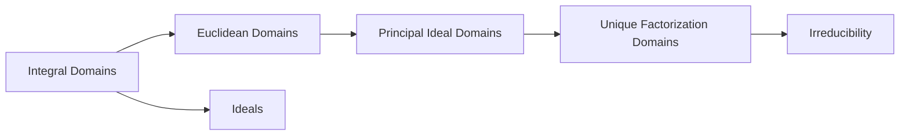

# Part I — Algebraic Foundations

Esta parte reúne los fundamentos de teoría de anillos utilizados posteriormente en Teoría Algebraica de Números.

## Contents

1. Integral Domains
2. Euclidean Domains
3. Principal Ideal Domains
4. Unique Factorization Domains
5. Ideals
6. Polynomial Irreducibility

## Dependency map

## Status

🚧 Material en proceso de organización.
