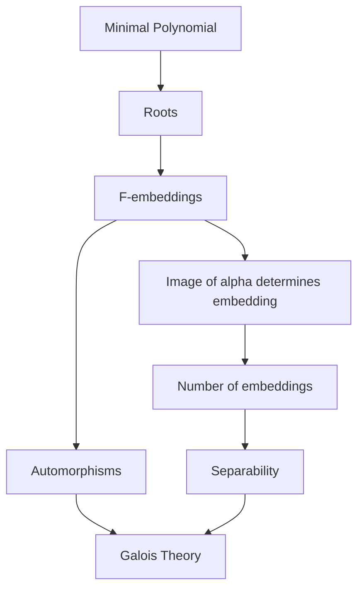

# Embeddings and Automorphisms

Este capítulo estudia las inmersiones entre extensiones de cuerpos y su relación con las raíces de polinomios irreducibles.

La idea fundamental es que, para una extensión simple $F(\alpha)/F$, una $F$-inmersión queda determinada por la imagen de $\alpha$, y dicha imagen necesariamente debe ser otra raíz del polinomio minimal de $\alpha$.

---

## Learning objectives

Al finalizar este capítulo, el estudiante debería poder:

- definir una $F$-inmersión;
- trabajar con el conjunto de inmersiones $\mathrm{Emb}_F(E,K)$;
- comprender cómo una inmersión actúa sobre las raíces de un polinomio;
- construir inmersiones de extensiones simples;
- relacionar raíces de polinomios minimales con inmersiones;
- calcular el número de inmersiones de una extensión simple;
- definir el grupo de automorfismos $\mathrm{Aut}(E/F)$;
- comprender la conexión inicial entre automorfismos, separabilidad y extensiones de Galois.

---

## Prerequisites

Se recomienda conocer:

- extensiones de cuerpos;
- elementos algebraicos;
- polinomios minimales;
- extensiones simples;
- cocientes de anillos;
- primer teorema de isomorfismo.

En particular, utilizaremos repetidamente

$$
F(\alpha)
\cong
\frac{F[x]}{(m_{F,\alpha})}.
$$

---

# 1. Field homomorphisms

Sean $F_1$ y $F_2$ cuerpos y sea

$$
h:F_1\longrightarrow F_2
$$

un homomorfismo de cuerpos.

Como

$$
\ker(h)
$$

es un ideal de $F_1$, y los únicos ideales de un cuerpo son

$$
\{0\}
\qquad\text{y}\qquad
F_1,
$$

se obtiene

$$
\ker(h)=\{0\}.
$$

Por tanto, todo homomorfismo de cuerpos es inyectivo.

Esta observación explica por qué utilizamos la palabra **embedding** o **inmersión**.

---

# 2. $F$-embeddings

Sean $E/F$ y $K/F$ extensiones de cuerpos.

## Definition

Una aplicación

$$
\sigma:E\longrightarrow K
$$

se denomina **$F$-inmersión** si:

1. $\sigma$ es un homomorfismo de cuerpos;
2. $\sigma$ fija cada elemento de $F$.

Es decir,

$$
\sigma(a)=a
\qquad
\text{para todo }a\in F.
$$

Denotaremos por

$$
\mathrm{Emb}_F(E,K)
$$

al conjunto de todas las $F$-inmersiones de $E$ en $K$.

---

# 3. Roots of a polynomial

Sea

$$
f\in F[x]
$$

y sea $K/F$ una extensión.

Definimos

$$
Z_K(f)
=
\{\alpha\in K:f(\alpha)=0\}.
$$

Es decir, $Z_K(f)$ es el conjunto de raíces de $f$ que pertenecen a $K$.

---

# 4. Embeddings preserve roots

Sea

$$
f(x)
=
a_0+a_1x+\cdots+a_nx^n
\in F[x]
$$

y sea

$$
\alpha\in Z_K(f).
$$

Supongamos que

$$
\sigma\in\mathrm{Emb}_F(F(\alpha),K).
$$

Como

$$
f(\alpha)=0,
$$

tenemos

$$
a_0+a_1\alpha+\cdots+a_n\alpha^n=0.
$$

Aplicando $\sigma$,

$$
\sigma
\left(
a_0+a_1\alpha+\cdots+a_n\alpha^n
\right)
=
0.
$$

Como $\sigma$ fija $F$,

$$
\sigma(a_i)=a_i.
$$

Por tanto,

$$
a_0+a_1\sigma(\alpha)+\cdots+a_n\sigma(\alpha)^n=0.
$$

Así,

$$
f(\sigma(\alpha))=0.
$$

Por consiguiente,

$$
\boxed{
\alpha\in Z_K(f)
\Longrightarrow
\sigma(\alpha)\in Z_K(f).
}
$$

Una inmersión debe enviar una raíz de un polinomio sobre $F$ a otra raíz del mismo polinomio.

---

# 5. Isomorphisms induced by roots

Sea

$$
f\in F[x]
$$

mónico e irreducible.

Supongamos que

$$
\alpha,\beta\in Z_K(f).
$$

Como

$$
f=m_{F,\alpha}=m_{F,\beta},
$$

tenemos

$$
F[\alpha]
\cong
\frac{F[x]}{(f)}
\cong
F[\beta].
$$

Por tanto, existe un único $F$-isomorfismo

$$
\sigma:F[\alpha]\longrightarrow F[\beta]
$$

tal que

$$
\sigma(\alpha)=\beta.
$$

Como $\alpha$ y $\beta$ son algebraicos,

$$
F[\alpha]=F(\alpha),
\qquad
F[\beta]=F(\beta).
$$

Por tanto,

$$
\sigma\in\mathrm{Emb}_F(F(\alpha),K).
$$

---

# 6. Roots and embeddings

Supongamos ahora que $K$ es algebraicamente cerrado y

$$
K/F
$$

es una extensión.

Sea

$$
f\in F[x]
$$

irreducible y sea

$$
\alpha\in Z_K(f).
$$

Entonces existe una biyección

$$
Z_K(f)
\longleftrightarrow
\mathrm{Emb}_F(F(\alpha),K).
$$

A cada raíz

$$
\beta\in Z_K(f)
$$

le corresponde la única inmersión

$$
\sigma_\beta:F(\alpha)\longrightarrow K
$$

determinada por

$$
\sigma_\beta(\alpha)=\beta.
$$

En particular,

$$
\boxed{
\#\mathrm{Emb}_F(F(\alpha),K)
=
\# Z_K(m_{F,\alpha}).
}
$$

---

# 7. Why an embedding is determined by $\alpha$

Sea

$$
g(x)\in F[x].
$$

Todo elemento de $F(\alpha)$ puede escribirse utilizando $\alpha$.

Si

$$
\sigma_\beta(\alpha)=\beta,
$$

entonces

$$
\sigma_\beta(g(\alpha))
=
g(\beta).
$$

Por tanto, una vez conocida la imagen de $\alpha$, queda determinada toda la inmersión.

Esta es una de las ideas centrales del capítulo:

$$
\boxed{
\text{imagen de }\alpha
\quad\Longrightarrow\quad
\text{inmersión completa}.
}
$$

---

# 8. Example: $x^3-2$

Consideremos

$$
f(x)=x^3-2.
$$

Sea

$$
\alpha=\sqrt[3]{2}
$$

y sea $\omega$ una raíz cúbica primitiva de la unidad.

Las raíces de $f$ en $\mathbb C$ son

$$
\alpha,
\qquad
\alpha\omega,
\qquad
\alpha\omega^2.
$$

Por tanto,

$$
Z_{\mathbb C}(f)
=
\{\alpha,\alpha\omega,\alpha\omega^2\}.
$$

Existen entonces tres $\mathbb Q$-inmersiones de

$$
\mathbb Q(\alpha)
$$

en $\mathbb C$:

$$
\sigma_\alpha,
\qquad
\sigma_{\alpha\omega},
\qquad
\sigma_{\alpha\omega^2},
$$

determinadas respectivamente por

$$
\sigma_\alpha(\alpha)=\alpha,
$$

$$
\sigma_{\alpha\omega}(\alpha)=\alpha\omega,
$$

y

$$
\sigma_{\alpha\omega^2}(\alpha)=\alpha\omega^2.
$$

Para todo

$$
g\in\mathbb Q[x],
$$

se tiene

$$
\sigma_\beta(g(\alpha))
=
g(\beta).
$$

---

# 9. Counting embeddings

De la biyección anterior obtenemos

$$
\#\mathrm{Emb}_F(F(\alpha),K)
=
\#Z_K(m_{F,\alpha}).
$$

Pero un polinomio de grado $n$ tiene a lo sumo $n$ raíces distintas.

Por tanto,

$$
\#Z_K(m_{F,\alpha})
\leq
\deg(m_{F,\alpha}).
$$

Como

$$
\deg(m_{F,\alpha})
=
[F(\alpha):F],
$$

concluimos que

$$
\boxed{
\#\mathrm{Emb}_F(F(\alpha),K)
\leq
[F(\alpha):F].
}
$$

La igualdad será fundamental en el estudio de **separabilidad**.

---

# 10. Automorphisms

Sea

$$
E/F
$$

una extensión.

## Definition

Definimos

$$
\mathrm{Aut}(E/F)
=
\mathrm{Emb}_F(E,E).
$$

Es decir, $\sigma$ pertenece a $\mathrm{Aut}(E/F)$ si es un $F$-isomorfismo

$$
\sigma:E\longrightarrow E.
$$

El conjunto

$$
\mathrm{Aut}(E/F)
$$

es un grupo con respecto a la composición.

Su elemento identidad es

$$
\mathrm{id}_E.
$$

---

# 11. Embeddings versus automorphisms

Si $K$ es algebraicamente cerrado y contiene a $E$, entonces

$$
\mathrm{Aut}(E/F)
\subseteq
\mathrm{Emb}_F(E,K).
$$

Por tanto,

$$
\boxed{
|\mathrm{Aut}(E/F)|
\leq
\#\mathrm{Emb}_F(E,K).
}
$$

Más adelante veremos que si $E/F$ es separable,

$$
\#\mathrm{Emb}_F(E,K)
=
[E:F].
$$

Esto conduce a una caracterización fundamental de las extensiones de Galois:

$$
|\mathrm{Aut}(E/F)|
=
[E:F].
$$

---

# 12. Conceptual picture

La conexión fundamental es

$$
\boxed{
\text{raíces}
\longleftrightarrow
\text{inmersiones}
\longrightarrow
\text{automorfismos}
\longrightarrow
\text{Galois}.
}
$$

---

# 13. Key results

Al terminar este capítulo conviene recordar:

$$
\sigma(\alpha)
\text{ es raíz de }
m_{F,\alpha}.
$$

Además,

$$
Z_K(m_{F,\alpha})
\longleftrightarrow
\mathrm{Emb}_F(F(\alpha),K).
$$

Por tanto,

$$
\#\mathrm{Emb}_F(F(\alpha),K)
\leq
[F(\alpha):F].
$$

Finalmente,

$$
\mathrm{Aut}(E/F)
=
\mathrm{Emb}_F(E,E).
$$

---

# Exercises

## Exercise 1

Sea

$$
\alpha=\sqrt2.
$$

Determina todas las $\mathbb Q$-inmersiones

$$
\mathbb Q(\sqrt2)
\longrightarrow
\mathbb C.
$$

**Difficulty:** ★☆☆☆☆

---

## Exercise 2

Sea

$$
\alpha=\sqrt[3]{2}.
$$

Determina todas las $\mathbb Q$-inmersiones

$$
\mathbb Q(\alpha)
\longrightarrow
\mathbb C.
$$

**Difficulty:** ★★☆☆☆

---

## Exercise 3

Sean $\alpha$ y $\beta$ raíces del mismo polinomio irreducible

$$
f\in F[x].
$$

Prueba que existe un único $F$-isomorfismo

$$
F(\alpha)\longrightarrow F(\beta)
$$

que envía $\alpha$ en $\beta$.

**Difficulty:** ★★★☆☆

---

# Next chapter

El número de inmersiones depende del número de raíces **distintas** del polinomio minimal.

Esto conduce naturalmente al siguiente concepto:

[`02-separability.md`](02-separability.md)

---

# Source

Este capítulo reorganiza el contenido del **Capítulo 1 — Inmersiones y Automorfismos** de las notas originales del curso.
