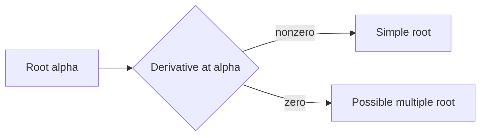
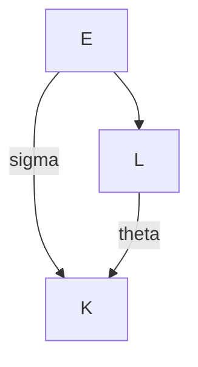
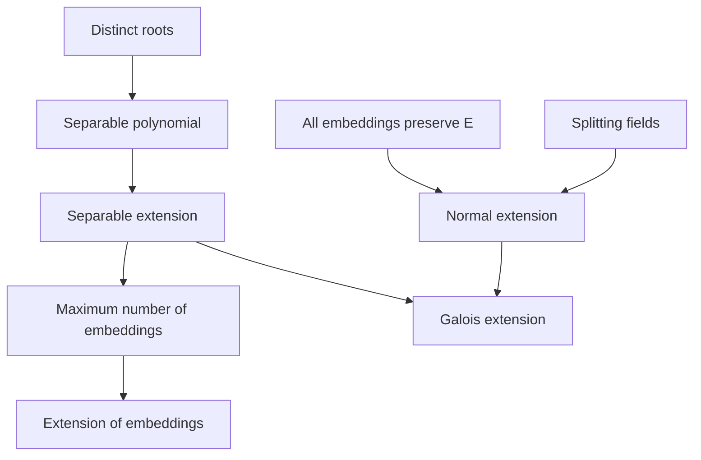

# Separability

Este capítulo estudia cuándo un polinomio algebraico posee raíces distintas y cómo esta propiedad controla el número de inmersiones de una extensión de cuerpos.

La idea central será:

$$
\text{raíces distintas}
\Longleftrightarrow
\text{separabilidad}
\Longleftrightarrow
\text{máximo número de inmersiones}.
$$

---

## Learning objectives

Al finalizar este capítulo, el estudiante debería poder:

- definir un polinomio separable;
- relacionar raíces simples con la derivada formal;
- definir la característica de un anillo;
- comprender por qué en característica cero los polinomios irreducibles son separables;
- definir extensiones separables;
- contar inmersiones de extensiones finitas separables;
- extender inmersiones a extensiones mayores;
- definir extensiones normales;
- distinguir extensiones separables, normales y de Galois;
- definir cuerpos de descomposición.

---

## Prerequisites

Se recomienda conocer:

- polinomios minimales;
- extensiones finitas;
- extensiones simples;
- $F$-inmersiones;
- automorfismos;
- correspondencia entre raíces e inmersiones.

En particular, utilizaremos

$$
Z_K(m_{F,\alpha})
\longleftrightarrow
\mathrm{Emb}_F(F(\alpha),K).
$$

---

# 1. Separable polynomials

Sea $F$ un cuerpo y sea $K$ una clausura algebraica de $F$.

## Definition

Sea

$$
f\in F[x]
$$

irreducible.

Decimos que $f$ es **separable** si en $K[x]$ puede escribirse como

$$
f(x)
=
(x-\alpha_1)(x-\alpha_2)\cdots(x-\alpha_n),
$$

con

$$
\alpha_i\neq\alpha_j
\qquad
\text{si }i\neq j.
$$

Es decir, todas las raíces de $f$ tienen multiplicidad $1$.

Equivalentemente,

$$
\boxed{
f\text{ separable}
\Longleftrightarrow
\#Z_K(f)=\deg(f).
}
$$

---

# 2. Separability and embeddings

Sea $\alpha$ una raíz de un polinomio irreducible

$$
f=m_{F,\alpha}.
$$

Sabemos que existe una biyección

$$
Z_K(f)
\longleftrightarrow
\mathrm{Emb}_F(F(\alpha),K).
$$

Por tanto,

$$
\#\mathrm{Emb}_F(F(\alpha),K)
=
\#Z_K(f).
$$

Si $f$ es separable,

$$
\#Z_K(f)=\deg(f).
$$

Como

$$
\deg(f)=[F(\alpha):F],
$$

obtenemos

$$
\boxed{
\#\mathrm{Emb}_F(F(\alpha),K)
=
[F(\alpha):F].
}
$$

Si $f$ no es separable,

$$
\#\mathrm{Emb}_F(F(\alpha),K)
<
[F(\alpha):F].
$$

---

# 3. Formal derivative

Sea $R$ un anillo.

Definimos la **derivada formal**

$$
\partial:R[x]\longrightarrow R[x]
$$

mediante

$$
\partial
\left(
\sum_{n=0}^{N}a_nx^n
\right)
=
\sum_{n=1}^{N}na_nx^{n-1}.
$$

Si $f$ es constante,

$$
\partial f=0.
$$

La derivada formal satisface:

$$
\partial(f+g)
=
\partial f+\partial g,
$$

$$
\partial(cf)=c\,\partial f,
$$

y la regla del producto:

$$
\boxed{
\partial(fg)
=
f\,\partial g
+
g\,\partial f.
}
$$

---

# 4. Simple roots and derivatives

Una raíz $\alpha$ de $f$ es simple si y solo si

$$
f(\alpha)=0
$$

y

$$
\partial f(\alpha)\neq0.
$$

Por tanto, la derivada formal permite detectar raíces múltiples.

Conceptualmente:

---

# 5. Characteristic

Sea $R$ un anillo con unidad.

## Definition

La **característica** de $R$, denotada por

$$
\mathrm{char}(R),
$$

es el menor entero positivo $n$ tal que

$$
n\cdot 1_R=0,
$$

si tal entero existe.

Si no existe, definimos

$$
\mathrm{char}(R)=0.
$$

Por tanto,

$$
\mathrm{char}(R)=0
$$

si y solo si

$$
n\cdot1_R\neq0
$$

para todo entero positivo $n$.

---

# 6. Derivatives in characteristic zero

Supongamos que $R$ es un dominio y

$$
\mathrm{char}(R)=0.
$$

Si $f\in R[x]$ no es constante, entonces

$$
\boxed{
\deg(\partial f)
=
\deg(f)-1.
}
$$

En efecto, si

$$
f=a_nx^n+\cdots+a_0,
\qquad
a_n\neq0,
$$

entonces

$$
\partial f
=
na_nx^{n-1}+\cdots.
$$

Como $R$ es dominio y la característica es cero,

$$
na_n\neq0.
$$

Por tanto, el término principal no desaparece.

---

# 7. Irreducible polynomials in characteristic zero

## Theorem

Sea $F$ un cuerpo con

$$
\mathrm{char}(F)=0.
$$

Si

$$
f\in F[x]
$$

es irreducible, entonces $f$ es separable.

### Proof idea

Sea $\alpha$ una raíz de $f$.

Como

$$
\deg(\partial f)
=
\deg(f)-1,
$$

no puede ocurrir que

$$
f\mid\partial f.
$$

Si

$$
\partial f(\alpha)=0,
$$

entonces

$$
\partial f
\in
\ker(\mathrm{ev}_\alpha)
=
(f),
$$

lo cual implicaría

$$
f\mid\partial f,
$$

contradicción.

Por tanto,

$$
\partial f(\alpha)\neq0.
$$

Todas las raíces son simples y $f$ es separable.

---

## Consequence over $\mathbb Q$

Como

$$
\mathrm{char}(\mathbb Q)=0,
$$

todo polinomio irreducible en

$$
\mathbb Q[x]
$$

es separable.

Por tanto, si $\alpha\in\mathbb C$ es algebraico,

$$
\boxed{
\#\mathrm{Emb}_{\mathbb Q}
(\mathbb Q(\alpha),\mathbb C)
=
[\mathbb Q(\alpha):\mathbb Q].
}
$$

---

# 8. Positive characteristic

En característica positiva el comportamiento puede ser distinto.

Consideremos

$$
\mathbb F_p.
$$

Para

$$
f(x)=x^p-1
$$

tenemos

$$
\partial f(x)
=
px^{p-1}
=
0.
$$

Además,

$$
x^p-1
=
(x-1)^p.
$$

Este ejemplo muestra cómo puede desaparecer la derivada en característica $p$.

Sin embargo, este polinomio no es irreducible.

Un ejemplo irreducible inseparable es

$$
f(x)=x^p-t
\in
\mathbb F_p(t)[x].
$$

Este polinomio satisface

$$
\partial f=0.
$$

---

# 9. Separable extensions

## Definition

Una extensión

$$
E/F
$$

se denomina **separable** si para todo

$$
\alpha\in E
$$

el polinomio minimal

$$
m_{F,\alpha}
$$

es separable.

---

# 10. Number of embeddings

Sea $E/F$ una extensión finita y sea $K$ algebraicamente cerrado.

Entonces

$$
\boxed{
\#\mathrm{Emb}_F(E,K)
\leq
[E:F].
}
$$

Además,

$$
\boxed{
\#\mathrm{Emb}_F(E,K)
=
[E:F]
\Longleftrightarrow
E/F\text{ es separable}.
}
$$

Esta igualdad será una de las herramientas fundamentales de la teoría de Galois.

---

# 11. Extension of embeddings

Sea

$$
L/E
$$

una extensión y sea

$$
\sigma:E\longrightarrow K
$$

una inmersión.

Decimos que

$$
\theta:L\longrightarrow K
$$

es una **extensión de $\sigma$** si

$$
\theta|_E=\sigma.
$$

Es decir, el siguiente diagrama conmuta:

---

# 12. Fundamental extension lemma

## Fundamental Lemma

Sea

$$
L/E
$$

una extensión finita y separable, y sea $K$ algebraicamente cerrado.

Entonces toda inmersión

$$
\sigma:E\longrightarrow K
$$

admite exactamente

$$
\boxed{
[L:E]
}
$$

extensiones

$$
\theta:L\longrightarrow K.
$$

---

## Simple case

Supongamos

$$
L=E(\alpha).
$$

Sea

$$
E_1=\mathrm{Im}(\sigma).
$$

La inmersión $\sigma$ induce un isomorfismo

$$
\sigma_*:E[x]\longrightarrow E_1[x].
$$

El polinomio

$$
m_{E,\alpha}
$$

se transforma en

$$
\sigma_*(m_{E,\alpha}).
$$

Como $L/E$ es separable, este último posee exactamente

$$
[L:E]
$$

raíces distintas.

Cada una determina una extensión distinta de $\sigma$ a $L$.

---

# 13. General finite separable extensions

Para una extensión finita separable general

$$
L/E,
$$

el resultado se prueba utilizando una torre

$$
E
\subset
E(\alpha)
\subseteq
L
$$

y la fórmula

$$
[L:E]
=
[L:E(\alpha)]
[E(\alpha):E].
$$

Cada extensión de $\sigma$ a $E(\alpha)$ admite posteriormente extensiones a $L$.

El número total de extensiones es

$$
[E(\alpha):E]\,[L:E(\alpha)]
=
[L:E].
$$

---

# 14. Elements fixed by all embeddings

Sea

$$
E/F
$$

finita y separable.

Si un elemento

$$
\alpha\in E
$$

satisface

$$
\sigma(\alpha)=\alpha
$$

para toda

$$
\sigma\in\mathrm{Emb}_F(E,K),
$$

entonces

$$
\boxed{
\alpha\in F.
}
$$

La intuición es que un elemento que no pertenece a $F$ tiene otros conjugados algebraicos y alguna inmersión debe enviarlo a uno de ellos.

---

# 15. Automorphisms

Recordemos que

$$
\mathrm{Aut}_F(E)
$$

denota los automorfismos de $E$ que fijan $F$.

Existe una inclusión natural

$$
\mathrm{Aut}_F(E)
\hookrightarrow
\mathrm{Emb}_F(E,K).
$$

Por tanto,

$$
|\mathrm{Aut}_F(E)|
\leq
\#\mathrm{Emb}_F(E,K)
\leq
[E:F].
$$

Si $E/F$ es separable,

$$
\#\mathrm{Emb}_F(E,K)
=
[E:F].
$$

---

# 16. Normal extensions

## Definition

Una extensión finita

$$
E/F
$$

es **normal** si es invariante bajo todas sus $F$-inmersiones:

$$
\sigma(E)=E
$$

para toda

$$
\sigma\in\mathrm{Emb}_F(E,K).
$$

Equivalentemente,

$$
\boxed{
E/F\text{ normal}
\Longleftrightarrow
|\mathrm{Aut}_F(E)|
=
\#\mathrm{Emb}_F(E,K).
}
$$

---

# 17. Galois extensions

## Definition

Una extensión

$$
E/F
$$

es **de Galois** si es:

- normal;
- separable.

En el caso finito,

$$
\boxed{
E/F\text{ Galois}
\Longleftrightarrow
|\mathrm{Aut}_F(E)|
=
[E:F].
}
$$

---

# 18. Example

Consideremos

$$
\mathbb Q(\sqrt[3]{2})/\mathbb Q.
$$

Esta extensión no es normal porque las otras raíces de

$$
x^3-2
$$

no pertenecen a

$$
\mathbb Q(\sqrt[3]{2}).
$$

En cambio,

$$
\mathbb Q(\sqrt[3]{2},\omega)
$$

contiene las tres raíces:

$$
\sqrt[3]{2},
\qquad
\sqrt[3]{2}\omega,
\qquad
\sqrt[3]{2}\omega^2.
$$

Esta extensión es normal sobre $\mathbb Q$.

---

# 19. Splitting fields

Sea

$$
f\in F[x].
$$

## Definition

El **cuerpo de descomposición** de $f$ sobre $F$ es

$$
F(\alpha_1,\ldots,\alpha_r),
$$

donde

$$
\{\alpha_1,\ldots,\alpha_r\}
=
Z_K(f).
$$

Es decir, es el cuerpo generado por todas las raíces de $f$.

---

## Example

Para

$$
f(x)=x^3-2,
$$

el cuerpo de descomposición sobre $\mathbb Q$ es

$$
\boxed{
\mathbb Q(\sqrt[3]{2},\omega).
}
$$

---

# 20. Conceptual summary

La estructura conceptual es:

$$
\text{separable}
+
\text{normal}
=
\text{Galois}.
$$

---

# 21. Key results

Conviene recordar:

$$
f\text{ irreducible},\quad
\mathrm{char}(F)=0
\Longrightarrow
f\text{ separable}.
$$

Para $E/F$ finita,

$$
\#\mathrm{Emb}_F(E,K)
\leq
[E:F].
$$

Y

$$
E/F\text{ separable}
\Longleftrightarrow
\#\mathrm{Emb}_F(E,K)
=
[E:F].
$$

Finalmente,

$$
E/F\text{ Galois}
\Longleftrightarrow
E/F\text{ normal y separable}.
$$

---

# 22. Preview: norm and trace

En las notas originales aparece en este punto una primera introducción a **norma** y **traza** para extensiones finitas de $\mathbb Q$.

No desarrollaremos todavía esta teoría aquí; se estudiará sistemáticamente en la unidad de anillos de enteros.

Si

$$
\mathrm{Emb}_{\mathbb Q}(E,\mathbb C)
=
\{\sigma_1,\ldots,\sigma_n\},
$$

se anticipan las definiciones

$$
N_{E/\mathbb Q}(\alpha)
=
\prod_{i=1}^{n}\sigma_i(\alpha),
$$

y

$$
\mathrm{Tr}_{E/\mathbb Q}(\alpha)
=
\sum_{i=1}^{n}\sigma_i(\alpha).
$$

Estas construcciones reaparecerán posteriormente en:

`course/02-rings-of-integers/`

---

# Next chapter

El siguiente bloque utilizará separabilidad, normalidad y automorfismos para desarrollar la teoría de Galois y comenzar la transición hacia Teoría Algebraica de Números:

[`03-number-theory-transition.md`](03-number-theory-transition.md)

---

# Source

Este capítulo reorganiza el contenido del **Capítulo 2 — Separabilidad** de las notas originales del curso.
