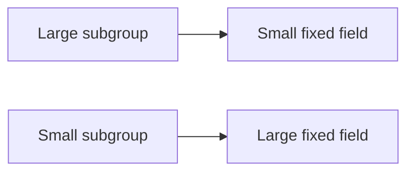
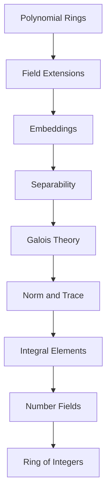

# From Galois Theory to Algebraic Number Theory

Este capítulo completa los preliminares de teoría de cuerpos y establece el puente hacia los objetos centrales de la **Teoría Algebraica de Números**.

La progresión conceptual será:

---

## Learning objectives

Al finalizar este capítulo, el estudiante debería poder:

- caracterizar extensiones finitas de Galois;
- definir el grupo de Galois;
- trabajar con campos fijos;
- utilizar la correspondencia fundamental de Galois;
- comprender que la correspondencia invierte inclusiones;
- definir la clausura normal de una extensión;
- definir norma y traza mediante inmersiones;
- comprender las propiedades elementales de norma y traza;
- definir elementos enteros sobre un anillo;
- definir cuerpos de números;
- definir el anillo de enteros $\mathcal O_K$;
- reconocer el punto donde comienza propiamente la Teoría Algebraica de Números.

---

## Prerequisites

Se utilizarán:

- extensiones finitas;
- extensiones separables;
- extensiones normales;
- cuerpos de descomposición;
- inmersiones;
- automorfismos;
- fórmula de la torre.

Recordemos que, para $E/F$ finita,

$$
|\mathrm{Aut}(E/F)|
\leq
\#\mathrm{Emb}_F(E,K)
\leq
[E:F].
$$

La primera igualdad caracteriza normalidad y la segunda separabilidad.

---

# 1. Finite Galois extensions

## Definition

Una extensión finita

$$
E/F
$$

es **de Galois** si es normal y separable.

Por tanto,

$$
\boxed{
E/F\text{ Galois}
\Longleftrightarrow
|\mathrm{Aut}(E/F)|=[E:F].
}
$$

Si $E/F$ es finita y separable, entonces también puede caracterizarse mediante cuerpos de descomposición:

$$
E/F\text{ Galois}
\Longleftrightarrow
E
\text{ es cuerpo de descomposición de algún }
f\in F[x].
$$

---

# 2. Galois group

## Definition

Si $E/F$ es una extensión finita de Galois, definimos

$$
\mathrm{Gal}(E/F)
=
\mathrm{Aut}(E/F).
$$

Además,

$$
\boxed{
|\mathrm{Gal}(E/F)|
=
[E:F].
}
$$

Esta igualdad convierte información sobre extensiones de cuerpos en información sobre grupos finitos.

---

# 3. Intermediate fields

Para una extensión $E/F$, definimos

$$
\mathcal E(E/F)
=
\{L\subseteq E:
L\text{ es subcuerpo y }F\subseteq L\}.
$$

Los elementos de $\mathcal E(E/F)$ son los **campos intermedios**:

$$
F\subseteq L\subseteq E.
$$

---

# 4. Fixed fields

Sea

$$
S\leq \mathrm{Gal}(E/F).
$$

## Definition

El **campo fijo** de $S$ es

$$
E^S
=
\{
\alpha\in E:
g(\alpha)=\alpha
\text{ para todo }g\in S
\}.
$$

Se tiene

$$
F\subseteq E^S\subseteq E.
$$

Además, $E^S$ es un subcuerpo de $E$.

---

# 5. Automorphisms fixing an intermediate field

Sea

$$
F\subseteq L\subseteq E.
$$

Definimos

$$
\mathrm{Aut}(E/L)
=
\{
g\in\mathrm{Aut}(E/F):
g|_L=\mathrm{id}_L
\}.
$$

Este es un subgrupo de $\mathrm{Gal}(E/F)$.

Así aparecen dos operaciones:

$$
S
\longmapsto
E^S,
$$

y

$$
L
\longmapsto
\mathrm{Aut}(E/L).
$$

---

# 6. Fundamental theorem of Galois theory

## Theorem — Galois Correspondence

Sea

$$
E/F
$$

una extensión finita de Galois.

Existe una biyección

$$
\boxed{
\left\{
\text{subgrupos de }\mathrm{Gal}(E/F)
\right\}
\longleftrightarrow
\left\{
\text{campos intermedios }F\subseteq L\subseteq E
\right\}.
}
$$

La correspondencia está dada por

$$
S
\longmapsto
E^S
$$

y su inversa por

$$
L
\longmapsto
\mathrm{Aut}(E/L).
$$

En particular,

$$
\boxed{
\mathrm{Aut}(E/E^S)=S
}
$$

y

$$
\boxed{
E^{\mathrm{Aut}(E/L)}=L.
}
$$

---

# 7. Inclusion reversal

La correspondencia de Galois **invierte inclusiones**.

Si

$$
S_1\leq S_2,
$$

entonces

$$
E^{S_2}\subseteq E^{S_1}.
$$

Y si

$$
L_1\subseteq L_2,
$$

entonces

$$
\mathrm{Aut}(E/L_2)
\leq
\mathrm{Aut}(E/L_1).
$$

Conceptualmente:

Este cambio de dirección es una de las ideas fundamentales de la teoría.

---

# 8. Degrees and subgroup indices

Sea

$$
G=\mathrm{Gal}(E/F)
$$

y sea

$$
F\subseteq L\subseteq E.
$$

Entonces

$$
|\mathrm{Aut}(E/L)|
=
[E:L].
$$

Por la fórmula de la torre,

$$
[E:F]
=
[E:L][L:F].
$$

Como

$$
|G|=[E:F],
$$

obtenemos

$$
\boxed{
[L:F]
=
(G:\mathrm{Aut}(E/L)).
}
$$

Por tanto, los grados de los campos intermedios corresponden a índices de subgrupos.

---

# 9. Artin's theorem

Sea $E$ un cuerpo y sea

$$
S\leq\mathrm{Aut}(E)
$$

un subgrupo finito.

Entonces

$$
\boxed{
[E:E^S]=|S|.
}
$$

En particular,

$$
S=\mathrm{Aut}(E/E^S).
$$

Este resultado constituye una pieza esencial de la correspondencia de Galois.

---

# 10. Normal closures

Sea

$$
E/F
$$

una extensión finita.

Escribamos

$$
E=F(\alpha_1,\ldots,\alpha_r)
$$

y sean

$$
m_{F,\alpha_1},
\ldots,
m_{F,\alpha_r}
$$

los respectivos polinomios minimales.

Consideremos

$$
f
=
m_{F,\alpha_1}
\cdots
m_{F,\alpha_r}.
$$

La **clausura normal** de $E/F$ se obtiene tomando el cuerpo de descomposición de $f$.

Es decir,

$$
\widetilde E
=
\mathrm{CDF}_F(f).
$$

Tenemos

$$
E\subseteq\widetilde E.
$$

Si $E/F$ es separable, entonces

$$
\widetilde E/F
$$

es una extensión finita de Galois.

---

# 11. Primitive elements

Para extensiones finitas separables sobre campos infinitos aparece un resultado importante:

$$
E/F\text{ finita separable}
\Longrightarrow
E=F(\alpha)
$$

para algún $\alpha\in E$.

En particular, toda extensión finita de

$$
\mathbb Q
$$

es simple.

Este resultado permite reducir muchos problemas de extensiones finitas a estudiar un único elemento algebraico.

---

# 12. Norm and trace

Sea

$$
E/F
$$

una extensión finita y separable.

Sea

$$
\mathrm{Emb}_F(E,K)
=
\{\sigma_1,\ldots,\sigma_n\},
$$

donde

$$
n=[E:F].
$$

## Definition — Trace

Definimos la **traza**

$$
\mathrm{Tr}_{E/F}:E\longrightarrow F
$$

por

$$
\boxed{
\mathrm{Tr}_{E/F}(\alpha)
=
\sum_{i=1}^{n}\sigma_i(\alpha).
}
$$

## Definition — Norm

Definimos la **norma**

$$
N_{E/F}:E\longrightarrow F
$$

por

$$
\boxed{
N_{E/F}(\alpha)
=
\prod_{i=1}^{n}\sigma_i(\alpha).
}
$$

---

# 13. Basic properties

La traza es aditiva:

$$
\boxed{
\mathrm{Tr}_{E/F}(\alpha+\beta)
=
\mathrm{Tr}_{E/F}(\alpha)
+
\mathrm{Tr}_{E/F}(\beta).
}
$$

La norma es multiplicativa:

$$
\boxed{
N_{E/F}(\alpha\beta)
=
N_{E/F}(\alpha)
N_{E/F}(\beta).
}
$$

Además,

$$
\mathrm{Tr}_{E/F}(\alpha)\in F
$$

y

$$
N_{E/F}(\alpha)\in F.
$$

---

# 14. Norm, trace and the minimal polynomial

Supongamos que

$$
E=F(\alpha)
$$

y que

$$
m_{F,\alpha}(x)
=
(x-\alpha_1)
\cdots
(x-\alpha_n).
$$

Entonces

$$
\mathrm{Tr}_{E/F}(\alpha)
=
\alpha_1+\cdots+\alpha_n
$$

y

$$
N_{E/F}(\alpha)
=
\alpha_1\cdots\alpha_n.
$$

Si

$$
m_{F,\alpha}(x)
=
x^n+a_{n-1}x^{n-1}
+\cdots+a_0,
$$

entonces

$$
\boxed{
\mathrm{Tr}_{E/F}(\alpha)
=
-a_{n-1}
}
$$

y

$$
\boxed{
N_{E/F}(\alpha)
=
(-1)^n a_0.
}
$$

---

# 15. Example: quadratic fields

Sea

$$
E=\mathbb Q(\sqrt d),
$$

con $d$ no cuadrado.

Las dos inmersiones en $\mathbb C$ están determinadas por

$$
\sqrt d\longmapsto\sqrt d
$$

y

$$
\sqrt d\longmapsto-\sqrt d.
$$

Para

$$
\alpha=a+b\sqrt d,
$$

se tiene

$$
\boxed{
\mathrm{Tr}_{E/\mathbb Q}(\alpha)=2a
}
$$

y

$$
\boxed{
N_{E/\mathbb Q}(\alpha)
=
a^2-b^2d.
}
$$

Además, cuando $b\neq0$,

$$
m_{\mathbb Q,\alpha}(x)
=
x^2
-
\mathrm{Tr}_{E/\mathbb Q}(\alpha)x
+
N_{E/\mathbb Q}(\alpha).
$$

---

# 16. Integrally closed domains

Sea $R$ un dominio y sea

$$
F=\mathrm{Frac}(R).
$$

## Definition

Decimos que $R$ es **integralmente cerrado** si todo elemento

$$
\alpha\in F
$$

que satisface algún polinomio mónico

$$
f\in R[x]
$$

pertenece ya a $R$.

Es decir,

$$
\alpha\in\mathrm{Frac}(R),
\qquad
f(\alpha)=0,
\qquad
f\text{ mónico}
\Longrightarrow
\alpha\in R.
$$

---

## Theorem

Todo dominio de factorización única es integralmente cerrado:

$$
\boxed{
R\text{ DFU}
\Longrightarrow
R\text{ integralmente cerrado}.
}
$$

Este resultado será crucial posteriormente para los anillos de enteros.

---

# 17. Integral elements

Sean

$$
R\subseteq K,
$$

donde $K$ es un cuerpo.

## Definition

Un elemento

$$
\alpha\in K
$$

es **entero sobre $R$** si existe un polinomio mónico

$$
f\in R[x]
$$

tal que

$$
f(\alpha)=0.
$$

La clausura integral de $R$ en $K$ es el conjunto

$$
\{
\alpha\in K:
\alpha\text{ es entero sobre }R
\}.
$$

---

# 18. Characterization using finite modules

Para

$$
\alpha\in K,
$$

las siguientes condiciones son equivalentes:

1. $\alpha$ es entero sobre $R$;
2. $R[\alpha]$ es finitamente generado como $R$-módulo;
3. existe un subanillo $M\subseteq K$, finitamente generado como $R$-módulo, tal que $\alpha\in M$.

Esta caracterización será una herramienta fundamental para probar que los enteros algebraicos forman un anillo.

---

# 19. Number fields

## Definition

Un **cuerpo de números** es una extensión finita

$$
K/\mathbb Q.
$$

Es decir,

$$
\boxed{
[K:\mathbb Q]<\infty.
}
$$

Ejemplos:

$$
\mathbb Q(\sqrt d),
$$

$$
\mathbb Q(\sqrt[3]{2}),
$$

$$
\mathbb Q(\zeta_n).
$$

---

# 20. Algebraic integers

## Definition

Sea $K$ un cuerpo de números.

Un elemento

$$
\alpha\in K
$$

es un **entero algebraico** si satisface algún polinomio mónico

$$
f\in\mathbb Z[x].
$$

---

# 21. Ring of integers

El conjunto de todos los enteros algebraicos contenidos en $K$ se denota por

$$
\boxed{
\mathcal O_K
=
\{
\alpha\in K:
\alpha\text{ es entero algebraico}
\}.
}
$$

Este conjunto será uno de los objetos centrales de todo el resto del curso.

Más adelante veremos que

$$
\mathcal O_K
$$

es un anillo.

---

# 22. Closure under addition and multiplication

Si $\alpha$ y $\beta$ son enteros algebraicos, entonces también lo son

$$
\alpha+\beta
$$

y

$$
\alpha\beta.
$$

Una estrategia consiste en mostrar que

$$
\mathbb Z[\alpha,\beta]
$$

es finitamente generado como $\mathbb Z$-módulo.

Por tanto, los enteros algebraicos forman un subanillo de $\mathbb C$.

---

# 23. Where Algebraic Number Theory begins

Hasta aquí hemos construido las herramientas de álgebra necesarias:

A partir de

$$
\boxed{
(K,\mathcal O_K)
}
$$

empieza el núcleo de la Teoría Algebraica de Números.

---

# 24. What comes next

Los siguientes temas de las notas originales ya pertenecen naturalmente a la unidad sobre **Rings of Integers**:

- estructura de $\mathcal O_K$;
- cuerpos cuadráticos;
- bases integrales;
- discriminantes;
- matriz de trazas;
- matriz de inmersiones;
- dominios de Dedekind;
- factorización de ideales.

Por tanto, continuarán en:

`course/02-rings-of-integers/`

---

# 25. Summary

Los conceptos principales de esta segunda parte quedan conectados de la siguiente manera:

Este es el punto de transición entre los **preliminares algebraicos** y la **Teoría Algebraica de Números propiamente dicha**.

---

# Source

Este capítulo reorganiza el contenido inicial del **Capítulo 3 — Teoría de Números** de las notas originales del curso.

El desarrollo detallado posterior de anillos de enteros, bases integrales y discriminantes será trasladado a su unidad temática correspondiente.
