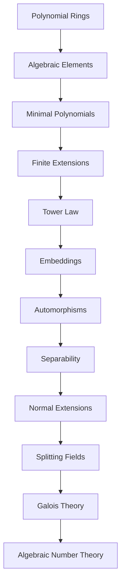

# Part II — Polynomials and Field Extensions

Esta parte desarrolla la teoría de polinomios y extensiones de cuerpos necesaria para el estudio posterior de Teoría Algebraica de Números.

---

## 0. Polynomials and Fields

Fundamentos de anillos de polinomios y extensiones de cuerpos.

Topics:

- polynomial division;
- $F[x]$ as a Euclidean domain;
- algebraic and transcendental elements;
- field extensions;
- finite extensions;
- evaluation homomorphisms;
- minimal polynomials;
- simple extensions;
- tower law;
- finitely generated extensions.

Read:

[`00-polynomials-and-fields.md`](00-polynomials-and-fields.md)

---

## 1. Embeddings and Automorphisms

Estudio de inmersiones entre extensiones de cuerpos.

Topics:

- $F$-embeddings;
- embeddings associated with roots of minimal polynomials;
- embeddings of simple extensions;
- automorphism groups;
- relation between roots and embeddings.

Read:

[`01-embeddings-and-automorphisms.md`](01-embeddings-and-automorphisms.md)

---

## 2. Separability

Estudio de raíces simples y extensiones separables.

Topics:

- separable polynomials;
- formal derivative;
- characteristic of a field;
- separable extensions;
- extension of embeddings;
- normal extensions;
- splitting fields.

Read:

[`02-separability.md`](02-separability.md)

---

## 3. Transition to Algebraic Number Theory

Este capítulo conecta la teoría de cuerpos con los objetos centrales del curso.

Topics:

- normal and Galois extensions;
- Galois correspondence;
- fixed fields;
- normal closures;
- norm and trace;
- algebraic integers;
- integral closure;
- number fields;
- rings of integers;
- integral bases;
- discriminants;
- introduction to Dedekind domains.

Read:

[`03-number-theory-transition.md`](03-number-theory-transition.md)

Parte de este contenido será desarrollada posteriormente y con mayor profundidad en:

[`../../02-rings-of-integers/`](../../02-rings-of-integers/)

---

## Learning path

---

## Source

Este material se basa en las notas de clase originales de la segunda parte del curso.

La versión original en LaTeX y PDF se conservará separadamente en `lectures/`.
