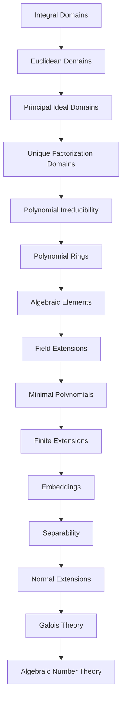
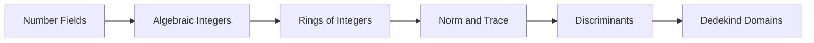

# Algebraic Preliminaries

Esta unidad reúne los fundamentos algebraicos y de teoría de cuerpos necesarios para comenzar el estudio sistemático de **Teoría Algebraica de Números**.

Los preliminares se dividen en dos partes principales.

---

## Part I — Algebraic Foundations

La primera parte desarrolla las estructuras algebraicas básicas utilizadas durante todo el curso.

### Topics

- Integral domains
- Divisibility
- Irreducible and prime elements
- Euclidean domains
- Principal ideal domains
- Unique factorization domains
- Ideals
- Polynomial irreducibility

Material:

[`01-algebraic-foundations/`](01-algebraic-foundations/)

---

## Part II — Polynomials and Field Extensions

La segunda parte desarrolla la teoría de cuerpos necesaria para estudiar posteriormente cuerpos numéricos, extensiones de Galois y anillos de enteros.

### Topics

- Polynomial rings
- Algebraic elements
- Field extensions
- Minimal polynomials
- Finite extensions
- Simple extensions
- Tower law
- Embeddings
- Automorphisms
- Separability
- Normal extensions
- Splitting fields
- Galois theory

Material:

[`02-polynomials-and-field-extensions/`](02-polynomials-and-field-extensions/)

---

## Dependency map

---

## Learning objectives

Al finalizar estos preliminares, el estudiante debería ser capaz de:

- trabajar con dominios, ideales y factorización;
- distinguir dominios euclídeos, PID y UFD;
- analizar irreducibilidad de polinomios;
- trabajar con extensiones finitas de cuerpos;
- calcular polinomios minimales;
- utilizar la fórmula de la torre;
- comprender inmersiones y automorfismos;
- reconocer extensiones separables y normales;
- trabajar con cuerpos de descomposición;
- utilizar los fundamentos de la teoría de Galois.

---

## Next step

Una vez completados estos preliminares, el curso continúa con los objetos centrales de Teoría Algebraica de Números:

Consulta también:

- [`ROADMAP.md`](../../ROADMAP.md)
- [`SYLLABUS.md`](../../SYLLABUS.md)
